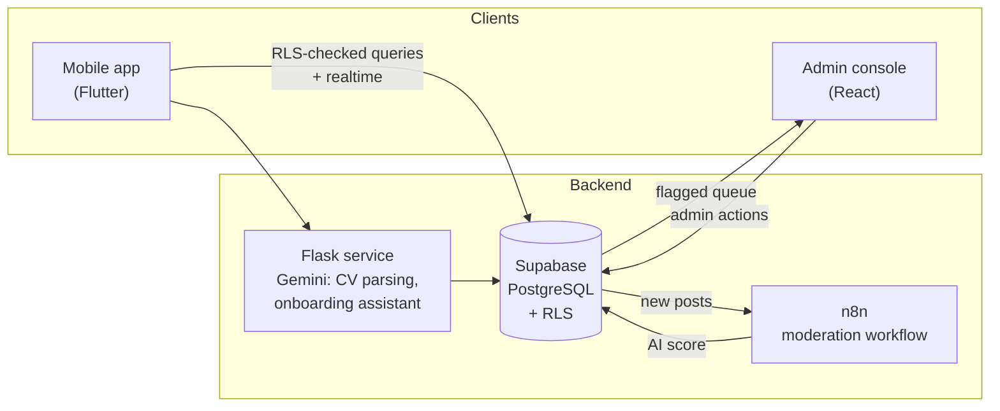

<div align="center">


<a href="https://git.io/typing-svg"></a>

<br/>

[](https://www.linkedin.com/in/reilyn-naidoo-50a346351/)
[](https://www.credly.com/users/reilyn-naidoo)


</div>

---

## 👋 Hi, I'm Reil

I'm a second-year IT Diploma student at **Richfield Graduate Institute of Technology** (Umhlanga campus) and a software developer who likes the parts of a system users never see: the schema, the access rules, the API in the middle, the pipeline that keeps bad data out.

In September 2026 I led a team of five to win the **Richfield National Hackathon**. We built **Richfield Connect**, a career network for students, alumni, employers and staff. I owned the database, the security model and the AI backend. Everything else on this page is either what I did before that, or what I've done since.

I'm writing this README the way I'd want a recruiter to read it: what I've shipped, what I'm good at, what I'm still learning, and what isn't mine.

<br/>

## 🧭 The short version

| | |
|:--|:--|
| 🎓 **Studying** | Diploma in Information Technology, Richfield (Umhlanga). Second year, finishing 2027 |
| 🏆 **Latest win** | Tech Lead, **2026 Richfield National Hackathon champions** (campus round 15 Sep, national final 17 Sep 2026) |
| 🧱 **I'm strongest at** | PostgreSQL, SQL, Supabase row-level security, Python and Flask services |
| 📊 **Also work with** | Power BI, pandas, scikit-learn, C++, JavaScript, React, Next.js |
| 🌱 **Learning now** | Applied machine learning beyond a first model, testing and CI, cloud fundamentals |
| 🎯 **Aiming for** | Software engineering, backend and AI, and data and cloud roles in 2027 |
| 📍 **Based in** | Durban, KwaZulu-Natal, South Africa |

<br/>

## 🏆 Featured: Richfield Connect

> **Winner, 2026 Richfield National Hackathon.** A four-role professional network (student, alumni, employer, admin) built for Richfield campuses, with the privacy and verification rules built into the database instead of bolted on afterwards.

**By the numbers (from the repo):** 87 pull requests merged · 50 SQL migrations · 74 row-level security policies · 33 tables

**What I built:**
- 🔐 **The security model.** Postgres row-level security with column-privilege locking, so no client can approve itself, promote itself or edit a field it doesn't own.
- ✅ **Verification gates.** Students, alumni and employers are checked against student numbers, certificate track IDs and business registration documents before they get access.
- 🤖 **The AI backend.** A Python/Flask microservice calling Google Gemini for structured CV parsing and an onboarding assistant.
- 🛡️ **Moderation pipeline.** Real-time updates over WebSockets, plus an n8n workflow that catches inappropriate posts, scores them with AI and queues them for a human to decide.



**The team (five of us, all first names):** I led and owned database, security, the AI backend, Supabase Edge Functions and push-notification delivery. **Keshav** led the mobile UI, the n8n automations and the testing. **Saiyusha** built the React admin console and the documentation. **Sashen** built the iOS version. **Diya** owned the presentation and the demo script.

**What isn't mine:** the Flutter app and the iOS build were my teammates' work. I wrote the backend they plugged into.

👉 [`reilisticdev/richfield-connect`](https://github.com/reilisticdev/richfield-connect)

<br/>

## 🛠️ Other things I've built

| Project | What it is | Stack |
|:--|:--|:--|
| [**VibraSafe**](https://github.com/reilisticdev/VibraSafe-Project) | An ear-cuff concept for Deaf and hard-of-hearing users that turns sirens, alarms and approaching vehicles into directional touch. I built the digital side (marketing site, companion app with a 3D model and simulator, Blender cuff generator) with a Grade 9 researcher. Won **1st place in Biomedical Sciences (Audiology)** and **2nd overall** at the Eskom Expo. It's an expo prototype, not a product. | Next.js · React · TypeScript · Tailwind · Three.js · Zustand · Blender (Python) |
| [**FUTURE_DS_02**](https://github.com/reilisticdev/FUTURE_DS_02) | Customer churn study. Baseline churn **17.55%**. A Random Forest flags at-risk customers (**80% test accuracy**) and feeds a Power BI action list. | Python · pandas · scikit-learn · Power BI · DAX |
| [**FUTURE_DS_01**](https://github.com/reilisticdev/FUTURE_DS_01) | Business sales analytics: Python ETL into a Power BI executive dashboard (revenue trends, profit margin by category and region). | Python · pandas · NumPy · Power BI |
| [**FUTURE_DS_03**](https://github.com/reilisticdev/FUTURE_DS_03) | Marketing funnel and sales pipeline dashboard: conversion bottlenecks, channel comparison, top reps. | Power BI · Power Query · DAX |
| [**SaiKet-Internship-Tasks**](https://github.com/reilisticdev/SaiKet-Internship-Tasks) | Six C++20 programs from my C/C++ internship, including a native Windows calculator written against the Win32 API with a hand-written message loop, plus console apps for a to-do list, text editor, tic-tac-toe, inventory and address book. | C++20 · Win32 · STL |
| [**richfield-career-app**](https://github.com/reilisticdev/richfield-career-app) | A Next.js career app, live on Vercel. The README is still the create-next-app template, which I'll fix. | Next.js · JavaScript · Vercel |
| [**AR-Magic**](https://github.com/reilisticdev/AR-Magic) | A browser experiment: manipulate 3D shapes with hand gestures. | Three.js · MediaPipe |

<br/>

## 🧰 Tech, sorted honestly

**Where I'm strongest (what I reach for first)**


Python · SQL and PostgreSQL · Supabase and row-level security · Flask services

**What I've used in shipped work**


C++ · JavaScript · React · Next.js · Tailwind CSS · Power BI · pandas and scikit-learn · Git and GitHub · Vercel · Blender scripting

**What I'm still learning**

Machine learning beyond a first model · automated testing and CI (my VibraSafe repo says outright that it has none) · cloud fundamentals (I've done the AWS Academy courses, which are training, not certification)

**What isn't my lane**

Mobile. Flutter and iOS were my teammates' work on Richfield Connect.

I use AI coding assistants and I read what they write. The schema design, the security rules and the architecture decisions are mine to defend.

<br/>

## 🗺️ Timeline

```text
2025   Start the Diploma in IT at Richfield (Umhlanga)
       Jul   Fortinet Certified Associate Cybersecurity, FortiGate 7.6 Operator, NSE 3
       Aug   Dean's List: Top Achiever, Semester 1
       Nov   OPSWAT Introduction to Critical Infrastructure Protection (ICIP)

2026   Jan–Feb  Data Science & Analytics Intern, Future Interns (three dashboard and ML projects)
       Feb–Mar  C/C++ Development Intern, SaiKet Systems (six C++ programs)
       Mar      3rd place, AWS Hackathon "Quack the CLI Code"
       May      IBM Dev Day: Bob Edition participant · Section scholarship (AI and business strategy)
       May–Jun  Google Data Analytics, Project Management, AI Essentials, AI Professional,
                Prompting Essentials, Digital Marketing · Meta Database Engineer (9 courses)
       Aug      IT Support Intern (Work-Integrated Learning), Mandini Academy
                1st in Biomedical Sciences (Audiology) and 2nd overall, Eskom Expo, with VibraSafe
       Sep      Tech Lead, Richfield Connect: campus round (15 Sep), national final (17 Sep). We won.
```

<br/>

## 📜 Credentials

**Earned and verifiable on [Credly](https://www.credly.com/users/reilyn-naidoo) or Coursera**
- Meta Database Engineer Professional Certificate (Coursera, June 2026)
- Google Data Analytics · Google Project Management · Google AI Essentials · Google AI Professional Certificate · Google Prompting Essentials · Google Digital Marketing
- Fortinet Certified Associate Cybersecurity · FortiGate 7.6 Operator · Fortinet NSE 3
- OPSWAT Introduction to Critical Infrastructure Protection (ICIP)

**Course completions and training badges (not certifications)**
- Cisco Networking Academy course badges, AWS Academy and AWS Educate training badges, IBM SkillsBuild and IBM Z Day 2025 badges, NEMISA Power BI course, Section "Become an AI Builder in a Day"

I keep these two lists apart on purpose. A training badge isn't an AWS certification, and I'd rather say so here than have you find out in an interview.

<br/>

## 🏅 Recognition

- 🥇 **Winner, 2026 Richfield National Hackathon** (Tech Lead, Richfield Connect)
- 🥇 **Winner, campus round**, same hackathon, 15 September 2026
- 🥇 **1st place, Biomedical Sciences (Audiology), and 2nd overall**, Eskom Expo, with VibraSafe
- 🥉 **3rd place**, AWS Hackathon "Quack the CLI Code" (March 2026)
- 🎓 **Dean's List:** Top Achiever, Semester 1, Year 1
- 🌟 **Youth Month Spotlight:** Top Achiever (June 2026)

<br/>

## 🤝 Beyond the keyboard

- Co-President of the Tech Society and SRC representative for my DIT Year 2 class at Richfield
- Peer tutor in Information Technology
- IT and audio-visual coordinator at NAPTOSA
- I study Business Management alongside IT, which is why I ask "who is this for and how will we know it worked" before I open the editor
- I make faith-based content on TikTok to encourage young people
- Attended **GitHub Copilot Dev Days** at Data & AI Community Day Durban in 2026

<br/>

## 🧠 How I work

1. **Put the rules in the database.** If a rule matters (who can approve whom, who can read what), it belongs in a policy, not in a front-end check someone can skip.
2. **Make the data model boring and correct first.** Everything downstream is cheaper after that.
3. **Say what's mine.** Credit the team, label the training badges, mark the prototype as a prototype.
4. **Ship, then tidy.** Some of my repos still need better READMEs. They're on the list.

<br/>

## 📫 Say hello

I'm after software engineering, backend and AI, and data and cloud roles for 2027, and I'm happy to talk about any of them.

[](https://www.linkedin.com/in/reilyn-naidoo-50a346351/)

<div align="center">


</div>
